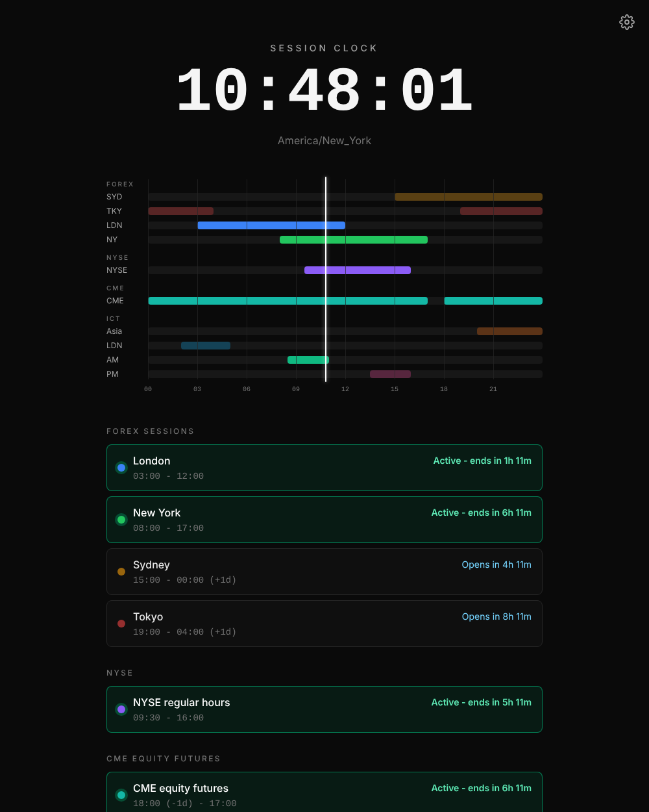

# Session Clock

[](https://github.com/latiryni-gilbert/session-clock/actions/workflows/ci.yml)

A web app that shows which trading sessions are open right now, and when the next ones open, in your local time.

**Live: [sessionclock.vercel.app](https://sessionclock.vercel.app/)**



## Features

- **Clock** with your detected time zone.
- **24-hour timeline** for your local day, with a moving "now" line. Overnight sessions are split at midnight, and active sessions are brighter.
- **Session list with live status:** "Active - ends in 1h 12m", "Opens in 3h 05m", or "Opens Sun 18:00" when the next open is more than a day away. Active sessions come first.
- **NYSE holidays and early closes:** on a closed day the NYSE row says why ("Closed - Thanksgiving Day") and still shows the next open. Early closes (13:00 ET) get a tag and a marker on the timeline, and a note warns when tomorrow is a holiday or an early close.
- **Presets:** Forex (Sydney, Tokyo, London, New York), NYSE regular hours, CME equity futures, and ICT killzones (Asian, London, New York AM, New York PM).
- **Custom windows:** add, edit and delete your own, each with its own time zone, days and color. Show or hide any window or group.
- **In-page alerts:** get a banner (and a quiet chime) 5, 15 or 30 minutes before a window opens. If the page was asleep, it catches up when you come back.
- **US news events:** CPI, jobs report (NFP), PPI and FOMC rate decisions are marked on the timeline, and a "Next event" line under the clock counts down to the next one, with a link to the full calendar on ForexFactory. FOMC meetings that publish projections are noted. Switch it off, or get an alert 5, 15 or 30 minutes before, in the settings.
- **Installable and offline:** install it like an app on your phone or computer. After the first visit it opens without a connection, and it asks before switching to a new version.
- **Desktop notifications:** optional, and only asked for when you turn them on. They are sent when the tab is in the background.
- **Background alerts (beta):** turn them on in Settings to get notifications even when the app is closed. For now you can only send yourself a test notification. See [Background alerts](#background-alerts-beta).

## News event data

News events come from the official BLS (CPI, Employment Situation, PPI) and Federal Reserve (FOMC) schedules, USD events only, entered through 2027 in `src/config/newsEvents.ts`. Times are New York time and are converted to yours. Nothing is fetched from ForexFactory; the link just opens its calendar in a new tab. A test fails when the data gets within 60 days of running out, as a reminder to add the next year.

## Install it

Open **[sessionclock.vercel.app](https://sessionclock.vercel.app/)** first, then:

- **iPhone or iPad (Safari):** tap the Share button, choose **Add to Home Screen**, then **Add**. Use Safari for the most reliable result; other iPhone browsers may not offer it.
- **Android (Chrome):** open the menu (⋮) and choose **Install app** (or **Add to Home screen**).
- **Desktop (Chrome or Edge):** click the install icon at the right end of the address bar, or open the menu and choose **Install Session Clock**. Safari 17 or later on a Mac: **File > Add to Dock**.

Once installed it opens in its own window without browser controls, and it keeps working offline. When a new version is released, a small "Update available" bar appears at the bottom; choose **Reload** to switch to it now, or dismiss it and the new version is used the next time you reopen the app.

## Time zones and daylight saving

Every window is defined in its own home time zone (the London session is 08:00 to 17:00 London time) and converted to your browser's zone for the specific date, using Luxon. Daylight-saving changes in either place are therefore handled automatically, and a start time that falls in a spring-forward gap moves to the next valid time. A window that ends before it starts runs past midnight and belongs to the day it starts on.

## Tech stack

React, TypeScript, Vite, Tailwind CSS, Luxon, Vitest and Testing Library, a service worker via vite-plugin-pwa (Workbox, with its own push handler in `src/sw.ts`), a Cloudflare Worker for push (`push-worker/`), GitHub Actions (CI), and Vercel (hosting).

## Run it locally

You need Node 22 (see `.nvmrc`).

```bash
git clone https://github.com/latiryni-gilbert/session-clock.git
cd session-clock
npm ci
npm run dev
```

Then open the address Vite prints (usually http://localhost:5173).

Other commands:

```bash
npm test         # run the tests once
npm run lint     # lint
npx tsc -b       # type check
npm run build    # production build into dist/
```

## Background alerts (beta)

Settings has a **Background alerts (beta)** section that uses Web Push, so a notification can reach you when Session Clock is closed. It talks to the push Worker in [`push-worker/`](push-worker/README.md). **This step covers subscribing and a test notification only**: scheduled alerts are not uploaded yet, so nothing is sent unless you press **Send test notification**.

- **Enable background alerts** asks for notification permission, subscribes this browser, and registers it with the Worker. The Worker gives back an id and a secret, which are kept in this browser's local storage and never shown or logged.
- **Send test notification** has the Worker push "Session Clock: Background alerts are working." to this device. It is limited to one a minute. If the Worker says the subscription is gone, the device is reset and you are offered **Enable** again.
- **Turn off** removes the device from the Worker, drops the browser's subscription and clears the saved id and secret.
- When Settings opens it checks the real situation: if you blocked notifications in the browser, or the browser dropped the subscription, it says so instead of showing "on".

**Configuration.** The section only appears when `VITE_PUSH_WORKER_URL` is set to the Worker's address, e.g. `https://session-clock-push.<your-subdomain>.workers.dev` (see `.env.example`). It is read when the app is **built**, so on Vercel add it under *Project > Settings > Environment Variables* (Production, and Preview if you want it there) and redeploy. Without it the feature is hidden and the app behaves exactly as before.

**Testing it on a computer** (Chrome, Edge or Firefox; **not a private/incognito window**, where Chrome has no push):

1. A service worker doesn't run in `npm run dev`, so use a build: put `VITE_PUSH_WORKER_URL=<the Worker's address>` in `.env.local`, then `npm run build && npm run preview` and open the address it prints (a local `wrangler dev` Worker at `http://localhost:8787` works too).
2. Open **Settings > Background alerts (beta)** and press **Enable background alerts**. Choose **Allow** when the browser asks. The section changes to "on".
3. Press **Send test notification**. A "Session Clock" notification should appear within a few seconds, with the app icon. To see that it works without the page: press the button and straight away switch to another tab or app, or close the Session Clock tab. The notification should still arrive. Click it and it brings Session Clock to the front, or opens it.
4. Press the button again straight away: it asks you to wait a minute.
5. Check the edge cases: in the browser's site settings set Notifications to **Block**, reopen Settings and it says alerts stopped. Then **Allow** it again and enable again. **Turn off** returns it to the start.
6. Your operating system can hide notifications (Focus or Do Not Disturb on macOS, Focus assist on Windows): check that if nothing appears.

**Testing it on an iPhone or iPad** (a real device on iOS or iPadOS 16.4 or later; push does not work in Safari tabs, and the simulator is not a reliable test):

1. Open the live site in **Safari**. In Settings the section says to add Session Clock to your Home Screen first, and there is no Enable button yet. That is the expected behavior outside the Home Screen app.
2. Tap Share, **Add to Home Screen**, **Add**. Then **open it from the new Home Screen icon**.
3. Open **Settings > Background alerts (beta)** and tap **Enable background alerts**. iOS asks to allow notifications: tap **Allow**. (iOS only asks from a tap, which is why it isn't automatic.)
4. Tap **Send test notification**. The notification appears at the top of the screen and in Notification Center. To check it works while the app isn't open, tap the button and then straight away lock the phone, go to the Home Screen, or swipe the app away: the notification should still arrive a few seconds later. Tap it and Session Clock opens.
5. If nothing appears, check *iPhone Settings > Notifications > Sessions* (the app's Home Screen name) and any Focus mode.

## Limitations

- **Scheduled alerts only work while the page is open.** Background alerts (beta) can currently send only a test notification; sending your real alerts in the background is not built yet.
- **Preset times are common conventions** and may differ from your source. Check them against your broker or exchange.
- **NYSE holidays and early closes are included through 2027; CME holiday hours are not modeled yet.**
- **Desktop notifications aren't available everywhere:** not on Android Chrome, and not on iPhone Safari outside a Home Screen app. In-page alerts still work there.
- Settings and custom windows are saved in your browser only, so they don't sync between devices.

## Built with AI-assisted development

This project was built with AI-assisted development using [Claude Code](https://claude.com/claude-code).
