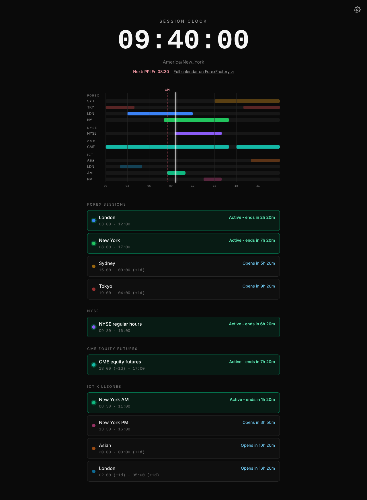
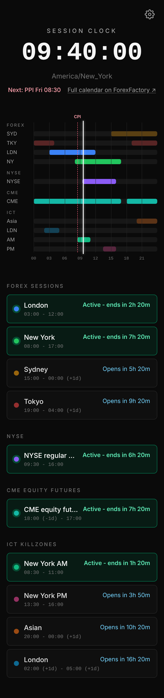
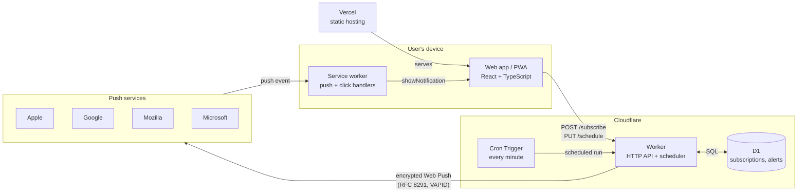
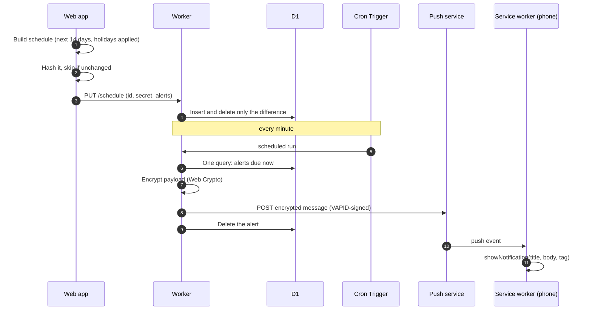

# Session Clock

[](https://github.com/latiryni-gilbert/session-clock/actions/workflows/ci.yml)
[](https://github.com/latiryni-gilbert/session-clock/actions/workflows/deploy-push-worker.yml)

An installable web app that shows which trading sessions are open right now, with alerts that reach your phone even when the app is closed.

**Live: [sessionclock.vercel.app](https://sessionclock.vercel.app/)**

<p align="center">
  
  &nbsp;
  
</p>
<p align="center"><sub>Taken with the clock frozen at 09:40 New York time on a CPI release day: five sessions are active and the CPI release is marked on the timeline.</sub></p>

The project has two parts:

| Part | What it is | Where |
|---|---|---|
| **Web app** | React + TypeScript single-page app and PWA | this folder, hosted on Vercel |
| **Push worker** | Cloudflare Worker + D1 database that stores alert schedules and sends Web Push notifications | [`push-worker/`](push-worker/README.md), the detailed backend reference |

## Features

- **Live clock and 24-hour timeline** in your time zone, with a moving "now" line. Overnight sessions are split at midnight.
- **Session list with live status:** "Active - ends in 1h 12m", "Opens in 3h 05m". Active sessions come first.
- **Presets:** Forex (Sydney, Tokyo, London, New York), NYSE regular hours, CME equity futures, ICT killzones. Add, edit and delete **custom windows** with their own zone, days and color.
- **NYSE holidays and early closes** (through 2027): a closed day says why and still shows the next open.
- **US news events** (CPI, jobs report, PPI, FOMC) on the timeline, with a "Next event" countdown.
- **Alerts** 5, 15 or 30 minutes before a window opens or a news event: in-page banner and chime, optional desktop notification, and, in beta, **background alerts** delivered by Web Push when the app is closed.
- **Installable and offline** (PWA). It asks before switching to a new version.
- **Daylight saving handled per window:** each window is defined in its own home zone and converted for the specific date (Luxon).

## Architecture



One background alert, from setting it to seeing it:



Details of the API, scheduler and database are in the [push worker README](push-worker/README.md).

## Key design decisions and trade-offs

### The app computes the schedule; the server only asks "what's due now?"
The app already knows how to turn windows, time zones, holidays, early closes and news dates into alert times, and it has the tests for that. It builds the next 14 days (at most 400 alerts, skipping anything due in the next 2 minutes) and uploads the list. The Worker never repeats that logic: each minute it runs one indexed query and pushes what it finds. That keeps one source of truth for what an alert is, and keeps the Worker's work small enough for the free plan's CPU limit (about 10 ms per run).
**Cost:** the schedule is a snapshot. Alerts last about 2 weeks after the app was last opened, and a corrected holiday or news date only reaches a device on its next open.

### D1 instead of KV
"What is due now?" is a query on time. In a key-value store that means listing keys and filtering, in pages. In D1 it is a partial index on `fire_at` for unsent alerts, so a minute with nothing due costs one read query and no writes. D1 also gives atomic batches for the diff on upload and cascading deletes when a subscription goes away.

### The write budget
D1's free tier allows 100,000 rows written a day, and every index entry counts as a row, so an alert costs about 6 rows from creation to deletion. Several layers keep that in check:
- **Hash and diff:** the Worker stores a hash of the last schedule. An unchanged upload writes nothing; a changed one deletes and inserts only the difference. The app also keeps its own hash and doesn't send unchanged schedules.
- **Rate limits** (Workers Rate Limiting): 3 `/subscribe` a minute per IP, 10 `/schedule` a minute per IP, and 2 schedule-changing uploads a minute per subscription.
- **Daily cap:** at most 400 alerts added plus removed per subscription per UTC day.
- **Delete on send:** a sent alert is deleted straight away rather than marked and cleaned up later.

By the [worked estimates](push-worker/README.md#write-budget) (assumptions listed there, not measurements), the budget supports on the order of 800 daily active users, and one misbehaving subscription costs at most about 2,000 rows a day.

### Fair retries and head-of-line blocking
One subscription whose pushes keep failing must not hold up everyone else. Each run ranks never-tried alerts before retries, stops pushing to a subscription for the rest of the run after one failure, looks at no more than 3 alerts per subscription, and deletes an alert after 3 failed attempts. Alerts more than 10 minutes late are dropped rather than sent, because a late session alert misleads. Every alert has a tag (`alert-<id>`, also sent as the push `Topic`), so a retry can't show twice on the device.

### Push encryption on Web Crypto
Web Push needs RFC 8291 message encryption and RFC 8292 VAPID signing. Both are implemented directly on the Workers runtime's Web Crypto, with no dependency. The test suite reproduces the RFC 8291 appendix A example byte for byte, and the output was also reproduced with `http_ece`, the RFC author's reference implementation, when the tests were written. The Worker only sends to the known push-service hosts and never follows redirects, so `/subscribe` can't be used to make it call arbitrary servers.

### Official data instead of a third-party calendar
News dates come from the published BLS (CPI, Employment Situation, PPI) and Federal Reserve (FOMC) schedules, USD events only, entered by hand in [`src/config/newsEvents.ts`](src/config/newsEvents.ts). A third-party calendar (ForexFactory) was rejected after reading its published copyright notice, which prohibits redistributing its calendar data. The app only links to ForexFactory's public calendar and fetches nothing from it. **Cost:** the data has to be extended by hand. A test fails once today is within 60 days of the end of the data (currently 2027-12-31).

### Accepted risks
- **Free-plan throughput is the ceiling.** A scheduler run sends at most 3 pushes (`MAX_PUSHES_PER_RUN`, 1 to 20), so about 180 an hour and about 30 alerts falling due in the same minute before the rest are too late. Fine for a handful of users, not for hundreds who all want the same open alert. The CPU margin was measured in Node, not on Cloudflare.
- **Abuse limits slow an attacker, they don't stop one.** Subscribing needs no account. Rate limits and the daily cap make it take effort to use up the daily write budget, but a deliberate attacker with enough subscriptions still can. Then the service answers `503` until 00:00 UTC. A challenge on `/subscribe` or a paid plan would close it; neither is done.
- **A push-service outage longer than about 3 minutes drops alerts**, since three failures delete an alert.

## CI/CD and operations

| | Web app | Push worker |
|---|---|---|
| **Pipeline** | Vercel hosts and deploys the app (configured in Vercel, outside this repository) | [`deploy-push-worker.yml`](.github/workflows/deploy-push-worker.yml) |
| **Checks** | [`ci.yml`](.github/workflows/ci.yml) on every pull request and push to `main`: `tsc -b`, oxlint, tests, build | Same workflow, a parallel job: type check and tests in the Workers runtime |

**Branch protection:** a ruleset on `main` requires a pull request and a passing CI check before anything can be merged, so a change only reaches `main` (and, for the Worker, production) after CI passes.

**Worker deploys** run on a push to `main` that touches `push-worker/` (or by hand, `main` only), one at a time:
1. Type check and tests again.
2. **Apply D1 migrations to the remote database first**, so new code never meets old tables.
3. Deploy, passing the commit SHA as `GIT_COMMIT_SHA`.
4. **Smoke test:** `/health` must report that exact commit and `pushConfigured: true` (a deploy succeeds even if the private key was never set, so this is the check that catches it).

**Migrations follow expand-then-contract:** the old code keeps running until the deploy step, so a migration may only add things; removing or renaming happens in a later change. Applied migrations are never edited.

**Secrets never live in code:**

| Value | Where |
|---|---|
| `VAPID_PRIVATE_KEY` | Cloudflare Worker secret |
| `CLOUDFLARE_API_TOKEN`, `CLOUDFLARE_ACCOUNT_ID` | GitHub Actions secrets |
| `PUSH_WORKER_URL` (smoke-test target) | GitHub Actions repository variable |
| `VITE_PUSH_WORKER_URL` (Worker address the app talks to) | build-time setting on Vercel; public by nature, and the feature is hidden without it |

The VAPID public key is public by design and is in `wrangler.jsonc`. For local runs, a throwaway key pair goes in `.dev.vars`, which Git ignores.

**Logs:** Workers Logs is on with invocation logs off, so request details and client addresses aren't recorded. The scheduler writes one counts-only line per run (`scheduler run: due=3 sent=1 ...`) and the Worker never logs endpoints, keys, secrets or notification text.

## Testing

Run on 2026-10-19, all passing:

| Suite | Tests | Files | Runs in |
|---|---|---|---|
| Web app, logic (`*.test.ts`) | 630 | 32 | Node |
| Web app, components (`*.test.tsx`) | 146 | 8 | jsdom, time zone pinned to America/New_York |
| Push worker | 446 | 11 | the Workers runtime (Cloudflare's Vitest integration) with a real local D1 |
| **Total** | **1,222** | **51** | |

- **Logic tests** cover time zones and daylight saving, holidays, alert timing and catch-up, the schedule builder, upload triggers and response handling.
- **Component tests** drive the UI with Testing Library: settings, window editing, alerts, the Background alerts section.
- **Worker tests** cover validation, the diff and hash logic, rate limits, the daily cap, the scheduler, fair retries, the write budget (using D1's `rows_written`) and the push encryption.
- **Mutation checks:** I deliberately break the logic that matters (boundaries, skips, hash checks, reset handling) and confirm a test fails. These are run by hand, not in CI.
- **Real runtime checks:** the app and Worker have been exercised together in real Chromium (Playwright) against a local `wrangler dev` Worker.
- **Real-device delivery** can't be automated, so it was checked by hand on the production setup in October 2026: a test push and a real scheduled alert both arrived on a locked iPhone (Home Screen app), and a test push arrived on desktop Chrome. The checklist is in [docs/background-alerts-testing.md](docs/background-alerts-testing.md).

## Limitations

- **Without background alerts, alerts only work while the page is open.** With them, alerts are scheduled 14 days ahead from the last time the app was opened.
- **Background alerts are beta.** They need a browser with push support; on iPhone the app must be added to the Home Screen first.
- **Preset times are common conventions** and may differ from your source. Check them against your broker or exchange.
- **NYSE holidays and early closes and news dates are included through 2027;** CME holiday hours are not modeled.
- **Desktop notifications aren't available everywhere:** not on Android Chrome, and not on iPhone Safari outside a Home Screen app. In-page alerts still work there.
- Settings and custom windows are saved in your browser only and don't sync between devices.

## Run it locally

You need Node 22 (see `.nvmrc`).

```bash
git clone https://github.com/latiryni-gilbert/session-clock.git
cd session-clock
npm ci
npm run dev        # http://localhost:5173
```

| Command | Does |
|---|---|
| `npm test` | run the tests once |
| `npm run lint` | lint (oxlint) |
| `npx tsc -b` | type check |
| `npm run build` | production build into `dist/` |

**Background alerts** are hidden unless `VITE_PUSH_WORKER_URL` is set at build time (see `.env.example`). To try them locally, run the Worker with `wrangler dev` (see the [push worker README](push-worker/README.md#develop)), set `VITE_PUSH_WORKER_URL=http://localhost:8787` in `.env.local`, then `npm run build && npm run preview`: the service worker doesn't run in `npm run dev`. A step-by-step checklist for computers and phones is in [docs/background-alerts-testing.md](docs/background-alerts-testing.md).

## Install it as an app

Open **[sessionclock.vercel.app](https://sessionclock.vercel.app/)** first, then:

- **iPhone or iPad (Safari):** Share, **Add to Home Screen**, **Add**.
- **Android (Chrome):** menu (⋮), **Install app** (or **Add to Home screen**).
- **Desktop (Chrome or Edge):** the install icon at the right end of the address bar. Safari 17 or later on a Mac: **File > Add to Dock**.

It then opens in its own window and works offline. When a new version is released an "Update available" bar appears; choose **Reload** to switch now, or the new version is used the next time you reopen the app.

## Tech stack

| | |
|---|---|
| App | React 19, TypeScript, Vite, Tailwind CSS v4, Luxon |
| PWA | `vite-plugin-pwa` (Workbox, custom service worker in `src/sw.ts`) |
| Push worker | Cloudflare Workers, D1, Workers Rate Limiting, Cron Triggers, Web Crypto |
| Tests | Vitest, Testing Library, jsdom, Cloudflare's Vitest integration |
| Tooling | oxlint, GitHub Actions, Vercel, `wrangler` |

## Data sources

- **News events:** BLS release schedules (CPI, Employment Situation, PPI) and the Federal Reserve FOMC calendar, USD events only, times in New York time converted to yours. Check them against bls.gov and federalreserve.gov before relying on them.
- **NYSE holidays and early closes:** the NYSE holiday and early-close schedule. Check it against nyse.com.
- **Session times:** common conventions, not an official source.

## License

[MIT](LICENSE) © 2026 LaTiryni Gilbert.

## Built with AI-assisted development

This project was built with AI-assisted development using [Claude Code](https://claude.com/claude-code).
